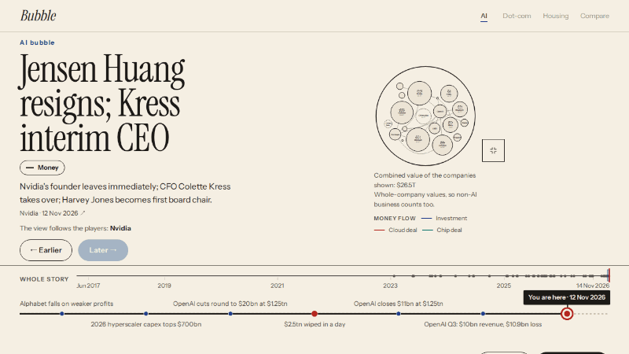
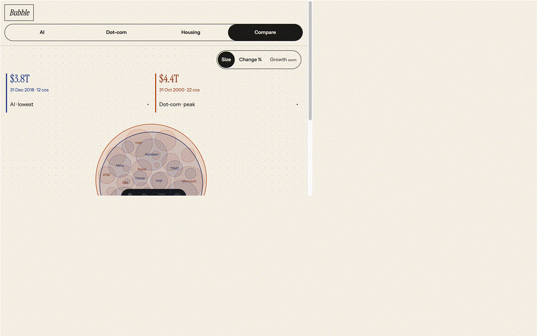

# The Bubble


**Everyone kept saying about the AI bubble, but have anyone actually see it?**
The site was created with a sole purpose of visualizing three economic bubbles: AI, Dot-com, and Housing. How each story connects and ties together in a simple way.


**See it live:** https://will-it-pop.rathtakrit.workers.dev


## What you can do

| Try| How?|
|---|---|
| **Scrub through time** | Drag the timeline, tap a dot or press Earlier / Later to move through the days. The bubble resizes and the news card explains what happened. |
| **Follow the money** | Arrows show investments (blue), cloud deals (orange) and chip deals (teal), each with its source. Tap a company to see its value, its money and its news. |
| **Compare past bubbles** | The dot-com bubble (burst 10 March 2000) and the housing bubble (burst 15 September 2008) sit beside it as tabs. The Compare tab lays two of them over each other, at their start, peak or today. |







This project is created for fun. Not a financial advice. Do not take anything for granted as there may be mistake.


## Where the numbers come from

Every value, deal and news item links to its source on the page. The data is plain JSON anyone can read:

| File | Holds |
|---|---|
| `data/companies.json` | The companies |
| `data/values.json` | Their values over time (mostly year-end market values, plus peaks and the latest value) |
| `data/deals.json` | Money moving between them |
| `data/news.json` | The news items on the timeline |
| `data/past/dotcom/`, `data/past/housing/` | The same files for the past bubbles |

**Found a wrong number or a dead link?** Open an issue with the item and a better source.

## Run it yourself

Needs Node 22 (see `.nvmrc`).

```
npm ci          # install
npm run dev     # start a local copy; open the address it prints
npm run check   # data checks, tests and a production build
```

Built with [Astro](https://astro.build) and TypeScript. Page code is in `src/`, the plan and every design decision in
[`docs/briefs/2026-11-15-aibubble.md`](docs/briefs/2026-11-15-aibubble.md), the design in `design/`.

## How it's made

This project is a bench test for AI coding agent system that is developing. Some features and fixes run overnight without supervision. For any more news in the AI bubbles, the dev will try to update.

Rules for anyone (or any agent) changing this repo: [`AGENTS.md`](AGENTS.md).
