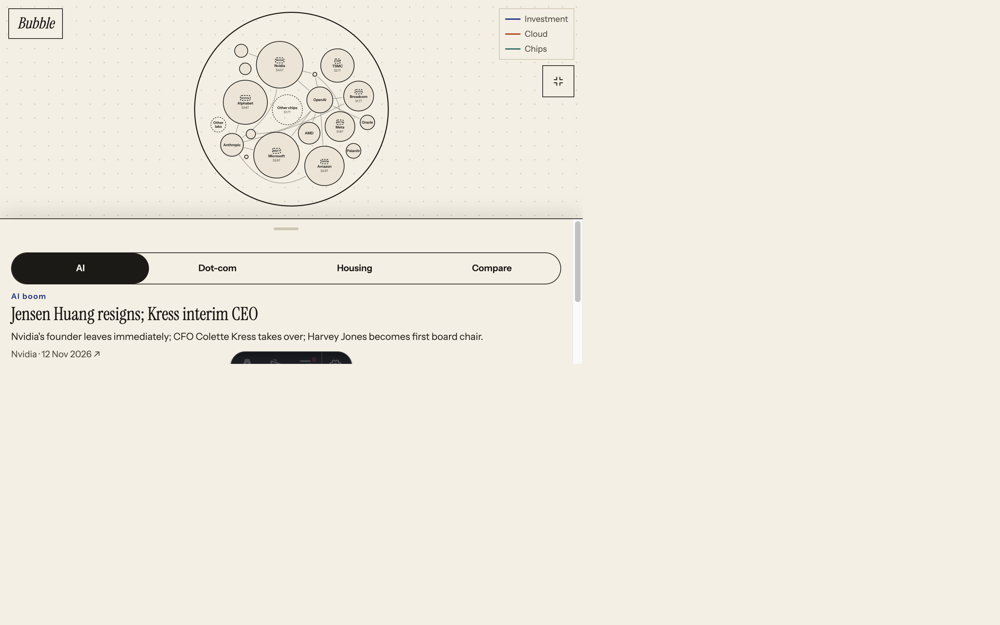
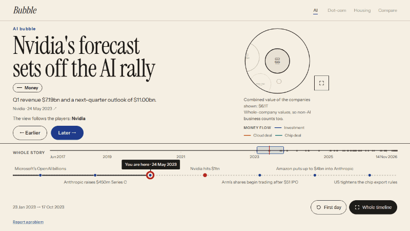
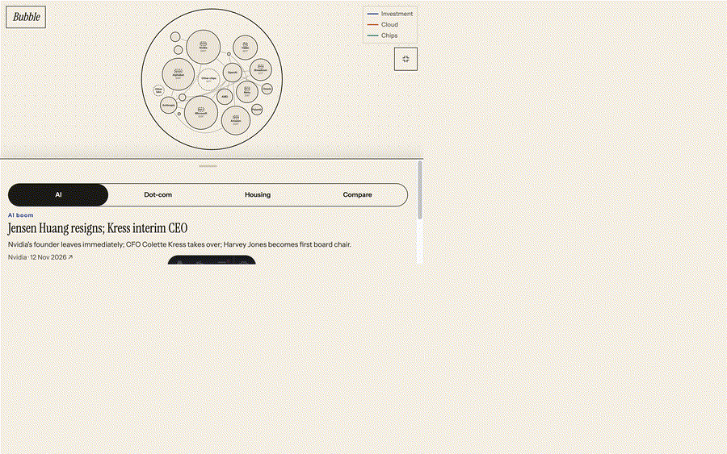

# The Bubble

Have you ever wanted to see an economic bubble take shape? This site visualises
three of them—AI, dot-com and housing—and shows how the companies, deals and
news connect over time.

**See it live:** https://will-it-pop.rathtakrit.workers.dev



The site also works on phones:


## What you can do

| Try | How? |
|---|---|
| **Scrub through time** | Drag the timeline or select a date to see the bubble and its news change. |
| **Follow the money** | Arrows show investments, cloud deals and chip deals, each with its source. |
| **Compare bubbles** | Compare AI, dot-com and housing values in the comparison view. |
| **Zoom into the map** | Focus on the players to inspect the companies and money flows. |

### See it in action

| Interaction | Preview |
|---|---|
| Compare bubbles |  |
| Scrub the timeline |  |
| Zoom into the money flows |  |

This is an explainer for learning and exploration, not financial advice. It
does not tell you to buy or sell, and it does not predict prices.


## Where the numbers come from

Every value, deal and news item links to its source on the page. The data is plain JSON anyone can read:

| File | Holds |
|---|---|
| `data/companies.json` | The companies |
| `data/values.json` | Their values over time (year-end market values for now) |
| `data/deals.json` | Money moving between them |
| `data/news.json` | The news items on the timeline |
| `data/past/dotcom/`, `data/past/housing/` | The same files for the past bubbles |

**Found a wrong number or a dead link?** Open an issue with the item and a better source.

## Run it yourself

Needs Node 22 (see `.nvmrc`).

```
npm ci          # install
npm run dev     # start a local copy; open the address it prints
npm run check   # data checks, tests and a production build
```

Built with [Astro](https://astro.build) and TypeScript. Page code is in `src/`,
the plan and design decisions are in
[`docs/briefs/2026-11-15-aibubble.md`](docs/briefs/2026-11-15-aibubble.md),
and the design files are in `design/`.

## How it's made

This project is also a test of an AI coding-agent workflow. Some features and
fixes run overnight without supervision and are checked in pull requests.
Anyone can contribute by opening an issue or submitting a pull request. The
data will be updated as new information about the bubbles becomes available.

Rules for anyone (or any agent) changing this repo: [`AGENTS.md`](AGENTS.md).
